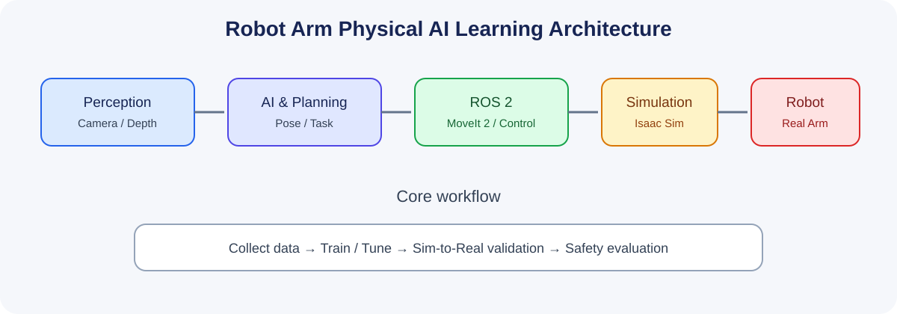

# 교육과정 1. 로봇팔 기반 Physical AI

> **교육시간:** 720시간(예시) · **대상:** 임베디드·로봇·AI 융합 실무 입문/전환 학습자  
> **핵심 목표:** 로봇팔의 구동·제어·기구학부터 ROS 2, 시뮬레이션, 비전 기반 조작 및 Sim-to-Real 검증까지 하나의 실습 프로젝트로 연결한다.

## 1. 교육 목표 및 인재상

수료자는 로봇팔의 모터와 구동계를 이해하고, 임베디드 제어와 ROS 2 기반 로봇 소프트웨어를 연결하며, 시뮬레이터에서 검증한 작업을 실제 장비에 안전하게 적용하는 기초 프로젝트를 수행한다.

- 모터·감속기·엔코더·드라이버의 역할과 인터페이스를 설명한다.
- 좌표계, 정기구학/역기구학, 궤적 생성의 기본을 구현한다.
- ROS 2, MoveIt 2, `ros2_control`을 사용해 로봇 모델과 작업 파이프라인을 구성한다.
- 카메라 기반 물체 인식·자세 추정·파지 실험을 수행한다.
- 시뮬레이션 결과와 실제 로봇의 차이를 측정하고 안전 기준에 따라 평가한다.

## 2. 권장 실습 환경

| 영역 | 권장 도구/장비 | 비고 |
|---|---|---|
| 임베디드 제어 | STM32 또는 동급 MCU, 모터 드라이버, 엔코더 | 저전압 교육용 장비 우선 |
| 로봇 미들웨어 | Ubuntu, ROS 2, RViz, MoveIt 2 | 배포판과 패키지 호환성 사전 확인 |
| 시뮬레이션 | NVIDIA Isaac Sim 또는 Gazebo | GPU 사양 및 버전 호환성 확인 |
| 인식 | RGB-D 카메라 또는 웹캠, OpenCV, PyTorch | 데이터 수집·평가 포함 |
| 기구 제작 | FreeCAD, 3D 프린터, 공구 | 실제 로봇은 안전 커버 및 비상정지 적용 |
| 협업 | Git, Markdown, 이슈·실험 기록 | 재현 가능한 결과물 관리 |

## 3. 세부 커리큘럼(총 720시간)

| 단계 | 교육 내용 | 시간 | 주요 결과물 |
|---|---|---:|---|
| 1 | 로봇팔 시스템 개론·안전·전기 기초 | 30 | 시스템 블록도, 위험요소 체크리스트 |
| 2 | 모터·전력전자·드라이버·엔코더 | 50 | 모터 구동 실습, 속도 측정 |
| 3 | 감속기·링크·기구 설계·3D 프린팅 | 60 | CAD 조립체, 제작 부품 |
| 4 | MCU 펌웨어·PWM·전류/속도/위치 제어 | 60 | 모터 제어 펌웨어 |
| 5 | 좌표계·정기구학·역기구학 | 60 | FK/IK 계산 및 시각화 |
| 6 | 궤적 생성·관절/말단 제어 | 50 | 관절 궤적 실행 및 오차 분석 |
| 7 | URDF·TF·RViz·로봇 모델링 | 40 | RViz에서 구동되는 로봇 모델 |
| 8 | ROS 2·MoveIt 2·`ros2_control` | 60 | 계획·실행 노드 및 데모 |
| 9 | GPU 컴퓨팅·AI 개발 환경 | 40 | AI 추론 환경 및 성능 기록 |
| 10 | Isaac Sim/Gazebo 시뮬레이션 | 60 | 디지털 로봇 셀, 센서 모델 |
| 11 | 비전·물체 자세 추정·파지·Sim-to-Real | 70 | 인식-파지 파이프라인, 오차표 |
| 12 | 데이터 수집·모방학습/VLA 개요·캡스톤 | 140 | 통합 프로젝트, 발표, README |
| **합계** |  | **720** |  |

## 4. 프로젝트 권장안

### 캡스톤: 비전 기반 물체 분류 및 로봇팔 픽앤플레이스

1. 카메라로 작업 영역과 물체를 관측한다.
2. 물체의 종류와 위치/자세를 추정한다.
3. 좌표 변환을 적용해 로봇팔 목표 자세를 계산한다.
4. 충돌을 고려해 경로를 계획하고 파지 동작을 실행한다.
5. 성공률, 작업시간, 위치 오차, 실패 유형을 기록한다.
6. 시뮬레이션과 실제 장비의 결과를 비교하고 개선한다.

**평가 지표 예시:** 픽앤플레이스 성공률, 목표 위치 오차, 반복성, 평균 작업시간, 비상정지·복구 동작의 적절성.

## 5. 평가 방법

- 모듈별 실습 및 코드 리뷰: 30%
- 중간 통합 과제(ROS 2 + 로봇 모델): 20%
- 캡스톤 기능 완성도·안전성·성능: 35%
- 문서화·재현성·발표: 15%

## 6. 운영상 유의사항

- 실제 로봇은 저속·저토크부터 시작하고, 비상정지와 작업영역 제한을 반드시 둔다.
- 모터 전원과 로직 전원을 분리하고, 정격 전류·발열·끼임 위험을 점검한다.
- Isaac Sim, ROS 2, MoveIt 2는 버전별 호환성이 달라질 수 있으므로 과정 개설 시점에 조합을 고정한다.
- 모방학습/VLA는 개념 소개 및 제한된 데이터 실습으로 시작하고, 모델의 일반화나 안전성을 과장하지 않는다.

## 7. 수료 산출물 체크리스트

- [ ] 회로/배선도 및 하드웨어 구성표
- [ ] 펌웨어와 ROS 2 패키지
- [ ] URDF 및 시뮬레이션 프로젝트
- [ ] 학습·평가 데이터와 실험 기록
- [ ] 캡스톤 영상, 결과 보고서, `README.md`
