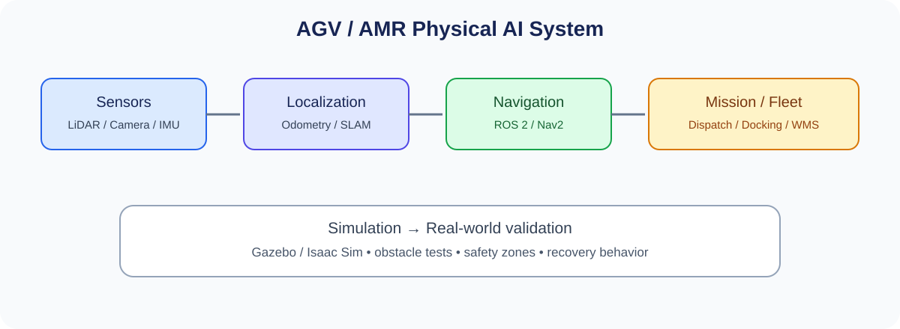

# 교육과정 2. AGV/AMR 기반 Physical AI

> **교육시간:** 720시간(예시) · **대상:** 스마트팩토리·물류자동화·모바일로봇 실무 입문/전환 학습자  
> **핵심 목표:** 이동로봇의 구동과 센서부터 위치추정·SLAM·경로계획·자율주행·관제 연동까지 구현한다.

## 1. 교육 목표 및 인재상

수료자는 AGV와 AMR의 차이 및 활용 환경을 이해하고, ROS 2 기반 이동로봇을 구성하여 지도 작성, 위치추정, 장애물 회피, 도킹 및 물류 미션을 시뮬레이션과 실제 플랫폼에서 검증한다.

- 구동계·전원·안전 센서와 임베디드 제어를 구성한다.
- 엔코더, IMU, LiDAR/카메라 데이터의 특성을 이해하고 융합한다.
- ROS 2, TF, odometry, SLAM, Nav2의 데이터 흐름을 구현한다.
- 경로계획, 장애물 회피, 목표 지점 도달 및 도킹을 시험한다.
- 임무 관리, 상태 모니터링, 실패 복구를 포함한 물류 데모를 제작한다.

## 2. 권장 실습 환경

| 영역 | 권장 도구/장비 | 비고 |
|---|---|---|
| 모바일 베이스 | 차동구동 또는 전방향 구동 플랫폼 | 저속 교육용부터 시작 |
| 제어기 | MCU + SBC/Jetson 계열 | 실시간 제어와 고수준 AI 역할 분리 |
| 센서 | 휠 엔코더, IMU, 2D LiDAR, RGB-D 카메라 | 센서 장착·시간 동기화 포함 |
| 소프트웨어 | Ubuntu, ROS 2, RViz, Nav2 | 배포판·드라이버 호환성 확인 |
| 시뮬레이션 | Gazebo 또는 NVIDIA Isaac Sim | 가상 장애물·센서 모델 |
| 통합 | Wi-Fi, MQTT/REST, 간단한 대시보드 | 실제 WMS/MES 연동은 확장 과제 |

## 3. 세부 커리큘럼(총 720시간)

| 단계 | 교육 내용 | 시간 | 주요 결과물 |
|---|---|---:|---|
| 1 | AGV/AMR 구조·활용사례·안전 | 30 | 요구사항·위험 분석 |
| 2 | 차동/전방향 구동·전원·모터 드라이버 | 50 | 베이스 구동 및 배선 |
| 3 | MCU 펌웨어·속도 제어·엔코더 | 60 | 저수준 주행 제어 |
| 4 | Odometry·IMU·센서 융합 | 60 | 이동 오차 분석 |
| 5 | Linux·ROS 2 노드·토픽·TF·액션 | 60 | 센서/제어 노드 |
| 6 | LiDAR·카메라·장애물 감지 | 60 | 센서 시각화 및 장애물 검출 |
| 7 | SLAM·지도 작성·위치추정 | 60 | 지도 및 위치추정 데모 |
| 8 | Nav2·경로계획·회피·도킹 | 60 | 목표점 주행 및 도킹 |
| 9 | Gazebo/Isaac Sim 환경 구성 | 50 | 가상 물류 공간 |
| 10 | 엣지 AI·객체 인식·가속 추론 | 50 | 로봇 탑재 인식 데모 |
| 11 | 시뮬레이션-실기체 검증·안전 복구 | 60 | 테스트 매트릭스, 실패 분석 |
| 12 | 물류 미션·관제·캡스톤 | 120 | 통합 AMR 프로젝트 |
| **합계** |  | **720** |  |

## 4. 프로젝트 권장안

### 캡스톤: 실내 자율주행 물류 AMR

- 작업 공간의 지도를 작성하고 시작 위치를 추정한다.
- 지정된 픽업/드롭오프 지점으로 자율주행한다.
- 정적·동적 장애물 상황에서 정지 또는 우회한다.
- 도킹 위치에서 정밀 정렬을 수행한다.
- 임무 요청과 로봇 상태를 대시보드에 표시한다.
- 센서 오류, 통신 단절, 경로 차단 시 안전한 정지 및 복구 절차를 검증한다.

**평가 지표 예시:** 목표 도착률, 위치 오차, 장애물 정지 성능, 도킹 오차, 임무 완료시간, 복구 성공률.

## 5. 평가 방법

- 센서·구동 실습: 25%
- ROS 2 및 SLAM/Nav2 중간 과제: 25%
- 캡스톤 자율주행·물류 시나리오: 35%
- 안전성·로그·문서화·발표: 15%

## 6. 운영상 유의사항

- AGV는 정해진 경로 중심, AMR은 환경 인지·경로 재계획 중심으로 비교하되 실제 제품은 기능이 혼재할 수 있음을 설명한다.
- 실제 플랫폼은 속도 제한, 비상정지, 범퍼/스캐너 등 안전 장치를 갖추고 테스트 구역을 분리한다.
- LiDAR 반사 특성, 유리·검은 표면, 조명 변화, 바닥 마찰 등 실제 환경 변수를 시험한다.
- ROS 2/Nav2 플러그인과 센서 드라이버는 배포판별 차이가 있으므로 실습 이미지와 버전을 고정한다.

## 7. 수료 산출물 체크리스트

- [ ] 하드웨어 구성도 및 전원/배선 문서
- [ ] MCU 펌웨어와 ROS 2 패키지
- [ ] 지도·파라미터·Nav2 설정
- [ ] 시뮬레이션 월드 및 테스트 시나리오
- [ ] 임무 관제 대시보드 또는 API
- [ ] 성능 평가표, 시연 영상, `README.md`
