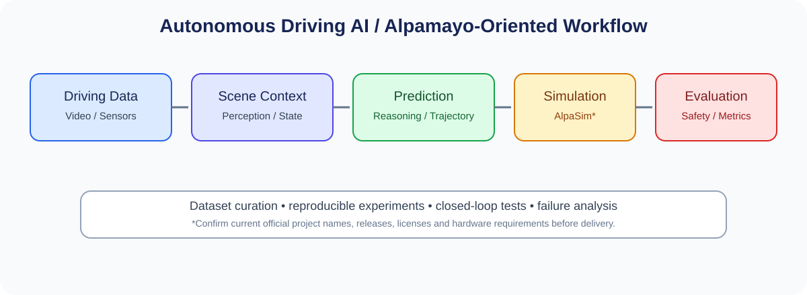

# 교육과정 3. NVIDIA Alpamayo 기반 자율주행 AI

> **교육시간:** 720시간(예시) · **대상:** AI·컴퓨터비전·자율주행 데이터 및 시뮬레이션 학습자  
> **핵심 목표:** 자율주행 데이터와 멀티모달 인지·행동 예측 모델을 이해하고, 시뮬레이션 및 체계적인 평가를 통해 안전 중심의 실험 파이프라인을 구성한다.

> **중요한 전제:** “Alpamayo” 및 관련 도구의 정확한 공개 모델, API, 라이선스, 하드웨어 요건은 과정 개설 시점의 공식 문서를 기준으로 확정한다. 아래 커리큘럼은 특정 비공개 기능을 가정하지 않고, 자율주행 AI·모델 평가·시뮬레이션 중심으로 구성한 교육 설계안이다. “AlpaSim” 등 연계 도구의 이름과 사용 가능 여부도 공식 자료로 재확인한다.

## 1. 교육 목표 및 인재상

수료자는 자율주행 데이터 파이프라인을 구축하고, 센서·좌표계·시간 동기화와 인지·예측·궤적 분석의 기초를 실습한다. 공개된 Alpamayo 관련 리소스가 제공하는 범위 안에서 모델 실행·평가를 수행하고, 시뮬레이션을 활용해 실패 사례와 안전 관련 지표를 분석한다.

- 주행 데이터의 구조, 라벨, 라이선스 및 개인정보·안전 고려사항을 이해한다.
- 카메라/센서 좌표계와 시간 동기화의 중요성을 설명한다.
- 인지 결과, 행동 예측, 궤적 및 설명/추론 출력의 평가 방법을 이해한다.
- 재현 가능한 모델 실행·추론·평가 파이프라인을 구성한다.
- 시뮬레이션 시나리오와 실패 사례 분석을 통해 제한사항을 보고한다.

## 2. 권장 실습 환경

| 영역 | 권장 도구/자원 | 비고 |
|---|---|---|
| 개발 환경 | Linux, Python, Git, Docker/Conda 중 기관 표준 | 환경 잠금 파일 제공 |
| GPU | NVIDIA GPU 워크스테이션 또는 클라우드 GPU | 실제 VRAM 요구량은 모델 버전 확인 |
| 데이터 | 공개 자율주행 데이터셋 및 승인된 교육용 샘플 | 라이선스·개인정보 정책 확인 |
| AI 프레임워크 | PyTorch, OpenCV, NumPy 등 | 버전 고정 |
| 시뮬레이션 | 공개적으로 이용 가능한 자율주행 시뮬레이터/시나리오 도구 | Alpamayo 연계성은 공식 지원 확인 |
| 실험 관리 | Jupyter, TensorBoard/W&B 등 기관 정책에 맞는 도구 | 데이터 반출 규칙 준수 |

## 3. 세부 커리큘럼(총 720시간)

| 단계 | 교육 내용 | 시간 | 주요 결과물 |
|---|---|---:|---|
| 1 | 자율주행 시스템·ODD·안전 개론 | 30 | 시스템 구성도, ODD 정의 |
| 2 | Python·Linux·Git·GPU 개발 환경 | 40 | 재현 가능한 개발 환경 |
| 3 | 센서 데이터·좌표계·시간 동기화 | 50 | 데이터 검사/정렬 스크립트 |
| 4 | 컴퓨터비전·장면 인지 기초 | 50 | 인지 결과 시각화 |
| 5 | 위치추정·행동 계획·차량 제어 기초 | 50 | 간단한 궤적/제어 실습 |
| 6 | 데이터셋·라벨링·평가 지표 | 60 | 데이터 카드, 평가 스크립트 |
| 7 | Alpamayo 관련 공개 자료·모델 구조 조사 | 60 | 공식 문서 기반 기술 보고서 |
| 8 | 추론 실행·행동/궤적 출력 분석 | 70 | 추론 결과 분석 노트북 |
| 9 | 시뮬레이션·폐루프 테스트 구성 | 70 | 재현 가능한 시나리오 세트 |
| 10 | 성능 평가·실패 사례·강건성 분석 | 70 | 오류 분류표, 평가 대시보드 |
| 11 | 제한적 모델 적용·최적화·안전 검토 | 60 | 개선 실험 보고서 |
| 12 | 캡스톤: 시나리오 기반 자율주행 AI 평가 | 110 | 데이터-모델-시뮬레이션 통합 결과 |
| **합계** |  | **720** |  |

## 4. 프로젝트 권장안

### 캡스톤: 주행 시나리오별 모델 평가 및 실패 분석

1. 허용된 데이터셋과 사용 조건을 확인하고 실험용 샘플을 선정한다.
2. 데이터 전처리, 좌표계/시간 동기화 및 시각화 파이프라인을 만든다.
3. 공식 공개 자료에서 지원하는 모델 또는 기준 모델을 실행한다.
4. 예측 궤적·행동 분류·인지 출력 등 실제로 제공되는 출력을 정량 평가한다.
5. 시뮬레이터에서 차선 변경, 합류, 보행자 출현, 가림, 악천후 등 시나리오를 시험한다.
6. 실패 사례와 한계를 기록하고 재현 가능한 보고서를 작성한다.

**평가 지표 예시:** 궤적 오차(해당 출력이 있을 경우), 시나리오 성공률, 충돌/위험 이벤트, 지연시간, 데이터 품질, 실패 유형별 비율. 지표는 모델의 실제 출력과 공식 평가 프로토콜에 맞춰 선택한다.

## 5. 평가 방법

- 개발환경·데이터 파이프라인: 20%
- 중간 모델 실행 및 평가 과제: 25%
- 시뮬레이션 시나리오와 실패 분석: 25%
- 캡스톤 재현성·기술 보고서·발표: 30%

## 6. 운영상 유의사항

- 공식 문서에서 지원하지 않는 API나 기능을 교육 자료에 확정적으로 기재하지 않는다.
- 주행 데이터의 라이선스, 개인정보, 얼굴/번호판 등 민감 정보 처리 정책을 준수한다.
- 시뮬레이션 결과를 실제 도로 안전성의 증거로 간주하지 않는다. 실차 시험은 별도의 안전·법규·승인 체계가 필요하다.
- 모델의 설명/추론 텍스트가 정확성이나 안전성을 보장한다고 가정하지 않고, 독립적인 정량 평가와 실패 분석을 병행한다.
- GPU 메모리와 실행 시간은 모델 크기·정밀도·배치·시퀀스 길이에 따라 달라지므로 사전 벤치마크를 실시한다.

## 7. 수료 산출물 체크리스트

- [ ] 개발환경 설치 및 버전 고정 문서
- [ ] 데이터셋 출처·라이선스·전처리 문서
- [ ] 추론 및 평가 코드
- [ ] 시뮬레이션 시나리오와 실행 기록
- [ ] 실패 사례 분석 보고서
- [ ] 최종 발표자료 및 `README.md`
