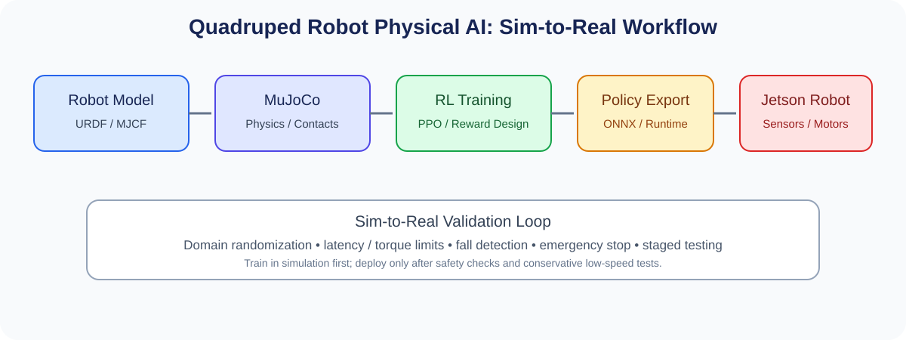

# 교육과정 4. 로봇 개(Quadruped) 기반 Physical AI — MuJoCo 강화학습부터 Jetson 실기체까지

> **교육시간:** 720시간 예시(선행 로봇·AI 기초 수준에 따라 540~900시간 조정 가능)  
> **최종 목표:** 4족 보행 로봇의 기구·구동·센서 모델을 시뮬레이션하고, MuJoCo 기반 강화학습으로 걷기와 이동 정책을 학습한 뒤, 안전한 실기체와 NVIDIA Jetson을 이용해 단계적으로 검증한다.



## 1. 교육 방향

이 트랙은 로봇팔이나 AMR와 달리 **동적 균형, 발-지면 접촉, 보행 주기, 전신 제어, sim-to-real 전이**가 핵심이다. 처음부터 고가의 실물 로봇에서 강화학습을 수행하기보다, 시뮬레이션에서 정책을 학습하고 검증한 후 실제 로봇에는 제한된 속도와 토크로 배포하는 방식을 권장한다.

### 수료 목표

- 4족 로봇의 링크·관절·액추에이터·IMU·발 접촉을 모델링한다.
- MuJoCo에서 관절 제어와 보행 환경을 구성한다.
- PPO 등 강화학습 알고리즘의 관측값, 행동값, 보상 함수를 설계하고 학습 결과를 분석한다.
- 학습 정책을 실시간 제어 루프에 연결하고, 지연·노이즈·마찰·질량 차이를 고려한다.
- Jetson에서 센서 취득, 정책 추론, 모터 제어 인터페이스 및 안전 감시를 통합한다.
- 평지 보행, 정지, 회전, 속도 명령 이동을 단계적으로 시연한다.

## 2. 시스템 아키텍처

```text
[MuJoCo + Robot Model]
         │ observation / action
         ▼
[RL Training: PPO + Reward + Curriculum]
         │ trained policy
         ▼
[Policy Export / Inference Runtime]
         │ joint targets or torque commands
         ▼
[Jetson: ROS 2 / Control / Safety Supervisor]
         ├── IMU / Joint Encoders / Foot Contact
         ├── Motor Drivers / Actuators
         ├── Teleoperation / E-stop
         └── Logs / Diagnostics
```

> Jetson은 주로 고수준 추론·센서 처리·로봇 통합에 사용하고, 모터의 고주파 폐루프 제어는 액추에이터 내장 제어기나 별도 MCU/실시간 제어기가 담당하도록 설계하는 편이 안전하고 현실적이다. 구체적인 분업은 모터 드라이버와 통신 인터페이스에 따라 결정한다.

## 3. 권장 개발 환경 및 장비

| 영역 | 권장 구성 | 확인할 사항 |
|---|---|---|
| 시뮬레이션 | MuJoCo, Python, NumPy | MuJoCo API 및 설치 버전 고정 |
| 강화학습 | PyTorch, PPO 구현체(예: Stable-Baselines3 또는 자체 구현) | 관측·행동 공간과 벡터 환경 호환성 |
| 로봇 모델 | MJCF 또는 URDF 변환/검증 | 질량, 관성, 관절 한계, 충돌 형상 |
| 로봇 미들웨어 | ROS 2, ros2_control 또는 프로젝트별 제어 노드 | Jetson OS와 ROS 2 배포판 호환성 |
| 엣지 컴퓨팅 | NVIDIA Jetson 계열 | 모델 크기, 메모리, 지연시간, 전력/열 |
| 액추에이터 | 교육용 4족 키트 또는 직접 제작한 저출력 플랫폼 | 토크·속도·백래시·열·전류 제한 |
| 센서 | IMU, 관절 엔코더, 가능하면 발 접촉 센서 | 캘리브레이션과 시간 동기화 |
| 안전 | 물리적 비상정지, 전원 차단, 리프트/하네스, 보호 구역 | 실기체 시험 전 필수 검토 |

**장비 선정 원칙:** 모터의 정격 토크·최대 전류·통신 속도·엔코더 해상도·제어 주기를 먼저 확인한 후 Jetson과 MCU를 선정한다. Jetson 모델 하나만으로 모터를 직접 구동할 수 있다고 가정하지 않는다.

## 4. 세부 커리큘럼 — 720시간

| 단계 | 교육 내용 | 시간 | 주요 결과물 |
|---|---|---:|---|
| 1 | 4족 로봇 구조·안전·동역학 개론 | 30 | 시스템 블록도, 위험 분석 |
| 2 | 링크·관절·기어·액추에이터·전원 | 45 | 구동계 사양표, 기구 구성 |
| 3 | 기구 모델링·CAD·URDF/MJCF | 55 | 로봇 모델 및 질량/관성 검증 |
| 4 | Python·Linux·MuJoCo 기초 | 45 | 시뮬레이션 환경과 관절 제어 |
| 5 | 좌표계·강체 운동·발 궤적·보행 패턴 | 55 | 보행 궤적 및 보행 주기 시각화 |
| 6 | 관절 PID·상태 추정·IMU/엔코더 처리 | 55 | 기본 자세 안정화·관절 제어 |
| 7 | 강화학습 기초·MDP·관측/행동 설계 | 45 | 환경 정의 및 baseline |
| 8 | PPO·보상 설계·커리큘럼 학습 | 90 | 평지 보행 정책 |
| 9 | 도메인 랜덤화·외란·강건성 평가 | 60 | 랜덤화 실험과 성능 비교 |
| 10 | Jetson·ROS 2·정책 추론 배포 | 55 | Jetson에서 추론하는 노드 |
| 11 | 실기체 센서/모터 통합·Sim-to-Real | 85 | 저속 보행·정지·회전 실험 |
| 12 | 캡스톤·문서화·시연·성능 평가 | 100 | 완성 프로젝트와 기술 보고서 |
| **합계** |  | **720** |  |

## 5. 강화학습 실습 로드맵

### 5.1 단계 A — 시뮬레이션과 관절 제어

- 로봇 모델의 링크 질량, 관성, 관절 범위, 충돌 모델을 확인한다.
- 각 관절에 위치/속도 목표를 넣고 제어 방향과 한계를 확인한다.
- IMU와 관절 센서의 관측값을 수집하고, 로봇이 넘어지는 조건을 재현한다.
- 먼저 PD/PID 또는 사전 정의한 보행 패턴으로 기준 성능을 만든다.

### 5.2 단계 B — 강화학습 환경 설계

**관측값 예시**
- 몸체의 각속도와 중력 방향 추정값
- 관절 위치 및 속도
- 이전 행동값
- 목표 선속도·회전속도 명령
- 필요 시 발 접촉 상태

**행동값 예시**
- 관절 목표 위치의 보정값 또는 관절 목표값
- 액추에이터 인터페이스가 지원되고 안전하게 검증된 경우에만 토크 명령을 고려한다.

**보상 항목 예시**
- 목표 속도 추종 및 전진 진행
- 몸체 자세와 높이 유지
- 발 미끄러짐과 불필요한 충격 감소
- 에너지/토크 사용량과 급격한 관절 움직임 억제
- 넘어짐 및 관절 한계 초과에 대한 큰 페널티

보상 가중치는 모델과 단위에 따라 달라지므로 고정된 숫자를 그대로 적용하지 말고, 항목별 보상 로그와 행동을 함께 확인하면서 조정한다.

### 5.3 단계 C — 점진적 난이도 상승

1. 평평하고 마찰이 일정한 바닥에서 서기
2. 제자리 자세 유지와 작은 외란 대응
3. 느린 직선 보행
4. 전진·후진 및 좌우 회전 명령 추종
5. 질량·마찰·센서 노이즈·지연의 랜덤화
6. 낮은 높이의 완만한 경사 등 제한된 지형
7. 실제 로봇에서 매우 낮은 속도로 정책 검증

계단, 점프, 빠른 달리기 등 고위험 동작은 기본 캡스톤 범위에서 제외하고 별도 기구·안전 검증 이후의 확장 과제로 둔다.

## 6. Jetson 실기체 완성 프로젝트

### 프로젝트 목표

**Jetson 탑재 4족 로봇이 명령에 따라 안전하게 서고, 걷고, 정지하고, 회전하는 것**을 1차 완료 기준으로 삼는다. 장애물 인식이나 음성 명령은 기본 보행이 안정된 후 확장한다.

### 소프트웨어 구성 예시

| 모듈 | 역할 |
|---|---|
| Sensor Driver | IMU·엔코더·접촉 센서 읽기 |
| State Estimator | 몸체 자세 및 관절 상태 추정 |
| Policy Inference | 학습된 정책으로 관절 명령 생성 |
| Low-level Controller | 관절 목표값 제한 및 제어 명령 전송 |
| Safety Supervisor | E-stop, 통신 타임아웃, 과전류/온도/자세 감시 |
| Teleoperation | 속도 명령, 정지, 시험 모드 선택 |
| Logger | 센서·행동·오류·추론 지연 기록 |

### 단계별 실기체 시험

- **Gate 0 — 전기/기구:** 무부하 관절 시험, 극성·엔코더 방향·전류 제한 확인
- **Gate 1 — 다리 단위:** 로봇을 지지대에 고정하고 각 관절의 제한된 움직임 검증
- **Gate 2 — 자세 유지:** 네 다리를 지지한 상태에서 센서와 제어 안정성 확인
- **Gate 3 — 하네스 보행:** 낮은 속도로 발을 움직이며 넘어짐과 비정상 토크 감시
- **Gate 4 — 바닥 보행:** 보호 구역에서 직선·정지·회전 시험
- **Gate 5 — 캡스톤:** 반복 주행, 명령 추종, 고장 시 안전 정지 및 결과 분석

실기체 전환은 각 Gate의 합격 조건을 충족한 뒤 진행한다. 비상정지는 소프트웨어 명령과 독립적으로 전원을 차단할 수 있는 구조를 우선 검토한다.

## 7. 캡스톤 평가 지표

| 항목 | 측정 방법 예시 |
|---|---|
| 보행 성공률 | 정해진 시간 동안 넘어지지 않고 미션 완료한 비율 |
| 속도 명령 추종 | 목표 속도와 실제 추정 속도의 오차 |
| 자세 안정성 | 몸체 롤/피치 변동과 회복 시간 |
| 에너지/전력 | 전류 또는 전력 로그, 가능한 경우 이동 거리당 에너지 |
| 정책 추론 | 평균/최대 지연시간, 주기 누락 |
| 안전 | E-stop 반응, 타임아웃 시 정지, 관절/전류 한계 준수 |
| 재현성 | 동일 설정에서 반복 시험 결과의 편차 |

## 8. 평가 방법 예시

- 시뮬레이션·로봇 모델: 20%
- 강화학습 환경과 보상 설계: 25%
- 강건성 및 sim-to-real 검증: 20%
- Jetson 통합 및 안전 시험: 20%
- 최종 시연·실험 보고서·코드 재현성: 15%

## 9. 위험 관리 및 운영상 주의사항

- 4족 로봇은 넘어짐, 발 끼임, 관절 과부하, 배터리 단락, 고속 관절 운동 위험이 있다. 교육 초기에는 낮은 전압·낮은 토크의 플랫폼을 사용한다.
- 학습 정책을 실제 로봇에 바로 적용하지 않는다. 시뮬레이션 검증, 하네스 시험, 속도·토크 제한, 비상정지 검증을 순서대로 수행한다.
- 실제 액추에이터의 제어 주기와 시뮬레이션의 시간 간격이 다를 수 있으므로 지연·노이즈·포화·백래시를 모델링한다.
- Jetson에서 고수준 AI와 모터의 안전 관련 실시간 제어를 무리하게 한 프로세스에 몰아넣지 않는다. 필요하면 MCU/전용 모터 제어기로 역할을 분리한다.
- 강화학습 결과는 환경 설정에 크게 좌우된다. 보상 함수, 시드, 모델 버전, 학습 로그 및 평가 시나리오를 함께 보관한다.

## 10. 수료 산출물 체크리스트

- [ ] 로봇 사양서·기구 모델·배선도
- [ ] MJCF/URDF와 MuJoCo 시뮬레이션
- [ ] 강화학습 환경·보상 함수·학습 설정
- [ ] 정책 파일과 Jetson 추론 코드
- [ ] 센서·모터 인터페이스 및 안전 감시 코드
- [ ] 시뮬레이션/실기체 성능 비교표
- [ ] 위험 분석, 시험 로그, 시연 영상
- [ ] 설치·실행 절차를 포함한 `README.md`

## 11. 공식 문서 확인 출발점

- MuJoCo: https://mujoco.org/
- MuJoCo 문서: https://mujoco.readthedocs.io/
- NVIDIA Jetson 개발자 문서: https://developer.nvidia.com/embedded/jetson
- ROS 2 문서: https://docs.ros.org/
- Stable-Baselines3 문서: https://stable-baselines3.readthedocs.io/

문서와 패키지의 버전, 지원 OS, GPU/메모리 요구사항은 실제 교육 장비에 맞춰 확정한다.
