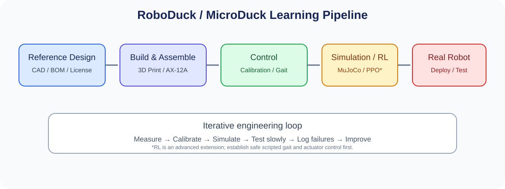

# 교육과정 5. RoboDuck / MicroDuck 기반 Physical AI — 자작·제어·시뮬레이션·강화학습

> **교육시간:** 720시간 예시 · **교육 방향:** 오픈 로봇 프로젝트를 참고해 4족 소형 로봇을 직접 설계·제작하고, 액추에이터 제어와 보행 알고리즘을 구현한 뒤 MuJoCo 시뮬레이션 및 강화학습으로 확장한다.  
> **최종 목표:** CAD·3D 프린팅·조립·서보 제어·보행·시뮬레이션·실기체 검증을 하나의 재현 가능한 프로젝트로 완성한다.

## 1. RoboDuck 과정의 성격

이 과정은 상용 고성능 로봇 개를 구매해 운용하는 과정이 아니라, **MicroDuck 계열의 소형 오픈 로봇 프로젝트를 바탕으로 로봇을 직접 만들고 이해하는 교육**으로 설계한다. 이전에 검토한 AX-12A 액추에이터 사용 계획을 기준 경로로 삼되, 원본 설계의 관절 수·서보 모델·통신 요구사항과 AX-12A의 크기·토크·무게가 일치하는지 먼저 검증한다.

MicroDuck 원본 또는 클론 프로젝트의 CAD를 그대로 혼합하기보다, 다음을 구분해 관리한다.

- **원본 참고:** 구조와 부품 배치, 소프트웨어 구조, 라이선스 확인
- **클론/파생 설계:** 부품 대체, 관절 브래킷 수정, 3D 프린팅 최적화
- **교육용 RoboDuck 변형:** AX-12A 적용 가능성을 검증하고, 필요한 경우 링크 길이·질량·기어비·전원 구성을 재설계

> **주의:** AX-12A는 토크·속도·무게·통신 방식 및 공급 전압 측면에서 다른 소형 서보와 동등하지 않다. 원본 프로젝트가 XL330 등 다른 액추에이터를 전제로 한다면 CAD와 제어 코드를 그대로 적용하지 말고, 장착 치수·관절 토크·전류·통신 프로토콜을 확인해야 한다.

## 2. 교육 목표

수료자는 다음을 수행할 수 있도록 한다.

- 오픈소스 로봇의 CAD, BOM, 라이선스, 펌웨어 및 시뮬레이션 자료를 조사·정리한다.
- CAD를 수정하고 3D 프린팅 부품을 제작해 기구물을 조립한다.
- AX-12A 또는 선정한 액추에이터의 통신, ID, baud rate, 영점 및 관절 한계를 설정한다.
- 다리별 관절 제어와 보행 패턴을 구현하고, 자세·속도·전력·발열을 측정한다.
- MuJoCo에서 로봇 모델을 검증하고, 강화학습을 적용할 수 있는 환경으로 확장한다.
- 실제 로봇에서 안전한 저속 보행을 검증하고, 설치·실행 절차를 README로 남긴다.

## 3. 권장 개발 환경 및 부품

| 분야 | 권장 구성 | 선정 시 확인할 사항 |
|---|---|---|
| 기구 설계 | FreeCAD 또는 원본 프로젝트의 CAD 도구 | 원본 파일 형식, 단위, 라이선스 |
| 제작 | FDM 3D 프린터, 나사·베어링·브래킷 | 출력 방향, 적층 강도, 공차 |
| 액추에이터 | AX-12A 기준 또는 원본 호환 서보 | 토크, 속도, 무게, 전류, 통신 |
| 제어기 | MCU/SBC 및 USB-시리얼 인터페이스 | 프로토콜과 실시간 제어 요구 |
| 전원 | 정격에 맞는 배터리·전원 분배·퓨즈 | 서보 피크 전류, 전압 강하, 발열 |
| 소프트웨어 | Python, Git, Linux/Windows 개발 환경 | 라이브러리 및 SDK 버전 |
| 시뮬레이션 | MuJoCo, MJCF; 필요 시 URDF 변환 | 관성·충돌 형상·관절 제한 |
| 강화학습 | PyTorch, PPO 계열 구현체 | 시뮬레이터 API와 모델 입력/출력 |
| 기록·문서화 | Markdown, 실험 로그, 동영상 | 재현 가능한 실행 절차 |

**권장 하드웨어 구성 원칙:** 모터 전원은 제어기 로직 전원과 적절히 분리하고, 공통 접지 및 통신 배선 조건을 확인한다. 서보의 정격 전류와 순간 피크 전류를 고려해 전원·배선·커넥터를 선정한다. PC 또는 SBC의 USB 전원으로 다수의 서보를 직접 공급하지 않는다.

## 4. 세부 커리큘럼 — 720시간

| 단계 | 교육 내용 | 시간 | 주요 결과물 |
|---|---|---:|---|
| 1 | 프로젝트 조사·원본/클론 비교·라이선스·요구사항 | 35 | 참고자료 목록, 요구사항 명세 |
| 2 | 4족 로봇 기구학·보행 원리·안전 | 40 | 링크/관절 구성도, 위험 분석 |
| 3 | CAD 분석·수정·부품 설계 | 65 | 수정 CAD, 부품 도면 |
| 4 | 3D 프린팅·후가공·조립 | 60 | 조립된 프레임, 조립 기록 |
| 5 | AX-12A/액추에이터 통신·캘리브레이션 | 65 | 서보 검색·ID 설정·영점 설정 도구 |
| 6 | 전원·배선·전류·열·고장 진단 | 40 | 전원/배선도, 측정 보고서 |
| 7 | 다리별 제어·역기구학·기본 보행 | 75 | 서기·다리 들기·느린 보행 |
| 8 | 센서·자세 추정·속도 명령 인터페이스 | 45 | IMU 통합 및 로그 |
| 9 | MuJoCo 모델링·시뮬레이션 검증 | 65 | MJCF 모델, 시뮬레이션 시나리오 |
| 10 | 강화학습 기초·PPO·보상 설계 | 75 | 학습 환경과 실험 결과 |
| 11 | 실기체 배포·Sim-to-Real·안전 시험 | 75 | 실기체 시험표, 성능 비교 |
| 12 | 캡스톤·문서화·시연 | 80 | 완성 RoboDuck, README, 시연 |
| **합계** |  | **720** |  |

## 5. 실습 단계

### 5.1 원본 자료 조사와 설계 검토

1. 원본 저장소, 클론, CAD 파생 프로젝트를 구분한다.
2. CAD 파일, BOM, 조립 순서, 펌웨어, SDK 및 시뮬레이션 파일을 목록화한다.
3. 부품별 라이선스와 재배포 조건을 확인한다.
4. 원본 액추에이터와 AX-12A의 크기·토크·속도·질량·통신 차이를 비교한다.
5. 변경 부품, 수정 이유, 예상 영향 및 검증 방법을 설계 변경 기록에 남긴다.

### 5.2 기구 제작과 조립

- FreeCAD에서 프레임·다리 링크·서보 브래킷의 간섭과 장착 치수를 확인한다.
- 3D 프린팅 전에 부품 방향, 인필, 벽 두께, 나사 체결부를 검토한다.
- 전체 프레임을 조립하기 전 단일 관절 브래킷으로 치수와 하중을 확인한다.
- 서보 케이블이 다리 운동 범위에서 당기거나 끼이지 않도록 배선한다.
- 조립 후 관절별 기계적 한계와 케이블 간섭을 확인한다.

### 5.3 액추에이터 제어와 기본 보행

먼저 강화학습 없이 안전한 기준 제어기를 만든다.

1. 서보 ID 및 통신 속도를 확인한다.
2. 관절별 영점, 방향, 가동 범위, 속도 제한을 설정한다.
3. 각 다리의 관절을 개별 시험하고 명령값과 실제 위치의 차이를 기록한다.
4. 로봇을 지지대에 고정한 상태에서 서기 자세를 구현한다.
5. 발 궤적과 위상 차이를 적용해 느린 보행 패턴을 만든다.
6. 전류·온도·위치 오차·넘어짐 여부를 측정한다.

### 5.4 MuJoCo 시뮬레이션

- 실제 기구의 링크 길이, 질량, 관성, 관절 제한을 MJCF 모델에 반영한다.
- 발과 지면의 접촉, 마찰, 충돌 형상을 확인한다.
- 시뮬레이션 관절 명령과 실제 액추에이터 명령의 단위·범위를 통일한다.
- 기준 보행 패턴을 시뮬레이션에서 먼저 실행하고 실제 로봇과 비교한다.
- CAD 변경이나 액추에이터 교체가 발생하면 시뮬레이션 모델도 함께 갱신한다.

### 5.5 강화학습 확장

강화학습은 기구와 기본 제어가 안정된 뒤 적용한다. 소형 서보 기반 로봇은 무게·토크·전원 여유가 제한될 수 있으므로, 고토크 토크 제어를 전제로 한 대형 4족 로봇의 정책을 그대로 이식하지 않는다.

**관측값 예시**
- 관절 위치·속도
- 몸체 각속도와 IMU 기반 자세 정보
- 목표 이동 속도 및 회전 명령
- 이전 행동값, 필요 시 발 접촉 상태

**행동값 예시**
- 관절 목표 위치의 작은 보정값
- 관절별 제한 범위 내 목표값

AX-12A의 내부 제어 구조와 제어 인터페이스가 허용하지 않는 직접 토크 제어는 가정하지 않는다.

**보상 설계 항목 예시**
- 목표 속도 추종
- 몸체 자세 및 높이 유지
- 발 미끄러짐과 불필요한 충격 감소
- 과도한 관절 움직임과 전력 소모 억제
- 넘어짐·관절 한계 초과에 대한 페널티

### 5.6 Sim-to-Real 검증

- 시뮬레이션에서 속도·마찰·질량·센서 노이즈를 변화시킨다.
- 실제 서보의 지연, 백래시, 위치 오차, 속도 제한을 측정한다.
- 실제 로봇에 적용하기 전에 정책 출력의 범위 제한과 타임아웃 정지를 구현한다.
- 하네스 또는 지지대 상태에서 시험한 후, 보호된 바닥 환경에서 저속 보행을 수행한다.
- 시뮬레이션과 실기체의 속도 추종 오차, 보행 성공률, 전류 및 발열을 비교한다.

## 6. 캡스톤 프로젝트

### 프로젝트명: AX-12A 기반 RoboDuck 자작 및 강화학습 보행

**필수 기능**
- 3D 프린팅 부품을 포함한 로봇 프레임 조립
- 액추에이터 검색·설정·캘리브레이션
- 안정적인 서기 자세와 기본 보행 패턴
- MuJoCo 로봇 모델 및 기준 시뮬레이션
- 선택적으로 PPO 기반 보행 정책 학습
- 실기체 저속 이동·정지·회전 시험
- 고장·통신 타임아웃 시 안전 정지
- 전체 제작·설치·실행 과정을 담은 README

**확장 기능**
- IMU 기반 자세 보정
- 원격 조종 인터페이스
- 장애물 감지 및 간단한 경로 이동
- 정책 추론을 위한 SBC/Jetson 탑재
- 실험 데이터 대시보드 및 자동 성능 평가

> Jetson 탑재는 선택 확장으로 둔다. 소형 RoboDuck의 제어 주기와 통신 요구에 따라 MCU 또는 기존 PC/SBC가 더 적합할 수 있다. Jetson을 사용하더라도 모터의 안전 관련 제어와 고주파 루프를 별도 제어기로 분리하는 설계를 우선 검토한다.

## 7. 평가 방법 예시

| 평가 항목 | 비율 |
|---|---:|
| 자료 조사·설계 변경 기록·라이선스 | 10% |
| 기구 설계·제작·조립 품질 | 20% |
| 액추에이터·전원·펌웨어 제어 | 20% |
| MuJoCo 모델·기본 보행 시뮬레이션 | 15% |
| 강화학습 또는 보행 제어 성능 | 15% |
| 실기체 안전성·재현성·문서화 | 20% |

## 8. 안전 및 프로젝트 관리

- 로봇을 처음 구동할 때는 몸체를 지지하고 관절을 제한된 범위로 움직인다.
- 서보 정격 전압과 피크 전류를 확인하고, 배터리 단락·과열·배선 역결선을 방지한다.
- 액추에이터의 내부 위치 제어와 교육용 강화학습 정책의 출력 형태를 구분한다.
- 넘어짐이나 관절 충돌 시 즉시 출력을 제한하거나 전원을 차단할 수 있도록 한다.
- 원본·클론 코드를 사용할 때 라이선스와 저작권 고지를 유지한다.
- 학습 결과와 CAD 변경사항은 버전 관리하고, 실험 환경·시드·파라미터·로그를 함께 보관한다.

## 9. 수료 산출물 체크리스트

- [ ] 원본/클론 자료 조사표와 라이선스 기록
- [ ] BOM, 수정 CAD, STL 및 조립 문서
- [ ] 배선도, 전원 계산, 액추에이터 설정 도구
- [ ] 펌웨어와 기본 보행 코드
- [ ] MuJoCo MJCF 모델과 시뮬레이션 결과
- [ ] 선택 과제: PPO 학습 설정·정책·평가 로그
- [ ] 실기체 안전 시험표와 성능 비교
- [ ] 설치·실행·문제 해결을 포함한 `README.md`

## 10. 참고 프로젝트 및 공식 문서

아래는 조사 출발점이다. 저장소의 현재 상태, 라이선스, CAD 파일, 하드웨어 호환성은 실제 사용 전에 직접 확인한다.

- Pollen Robotics MicroDuck: https://github.com/pollen-robotics/microduck
- MicroDuck RL 관련 프로젝트: https://github.com/pollen-robotics/microduck_rl
- MicroDuck replica 관련 프로젝트: https://github.com/fanhao375/microduck-replica
- MuJoCo: https://mujoco.org/
- MuJoCo 문서: https://mujoco.readthedocs.io/
- ROBOTIS DYNAMIXEL 문서: https://emanual.robotis.com/

저장소 URL이나 프로젝트 이름이 변경되었거나 접근할 수 없는 경우에는 조직/저장소 검색을 통해 현재 공식 자료를 확인하고, 확인되지 않은 CAD·코드·라이선스를 교육 자료에 확정적으로 기재하지 않는다.
